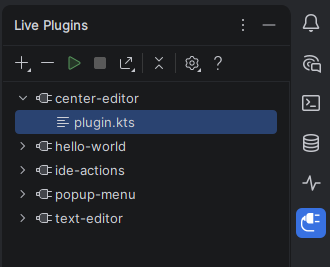
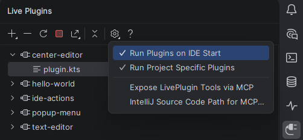

In most JetBrains IDEs the code is aligned to the very left of the editor. Only Distraction Free Mode and Zen Mode center it, and there is no setting for the normal view. This small [LivePlugin](https://plugins.jetbrains.com/plugin/7282-liveplugin) script centers the code in the default view as well.

If the editor is too narrow (e.g. two files split side by side), the padding shrinks automatically and falls back to the default left alignment. Consoles, diff views and the commit message box stay unchanged.

### Installation
1. Install **LivePlugin** by Dmitry Kandalov from the Marketplace (Settings → Plugins). Restart the IDE if prompted.
2. Open the new **Live Plugins** tool window from the tool window bar (usually vertical bar on the right side or just search "Live Plugins" via `Ctrl+Shift+A` / `Cmd+Shift+A`).
3. Click **+** → **Kotlin Plugin** and name it something like `center-editor`.
4. Open `center-editor/plugin.kts` and replace its contents with [`plugin.kts`](plugin.kts) from this repo.
5. Then select `center-editor` and click the green **Run** button. The first run takes a few seconds while the script compiles.
6. To keep it active after restarts, enable **Run Plugins on IDE Start** in the Live Plugins tool window settings.

## Configuration
Edit the values at the top of `plugin.kts`, save, and click **Run** again:

| Setting          | Default | Description                                                            |
|------------------|---------|------------------------------------------------------------------------|
| `contentColumns` | `120`   | Width of the centered code area in characters. Lower = padding stays in narrower editors. |
| `maxMargin`      | `0`     | Maximum left padding in pixels (`0` = no limit). Useful on ultrawide screens. |

## Disabling
Press the red **Unload** button in the Live Plugins tool window. Disable **Run Plugins on IDE Start** (or delete the `center-editor` plugin) and restart the IDE.
